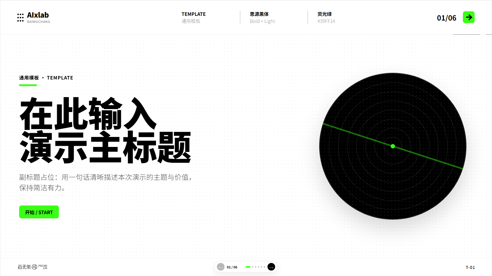
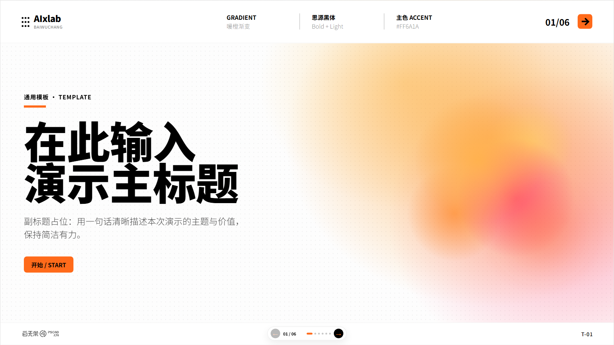
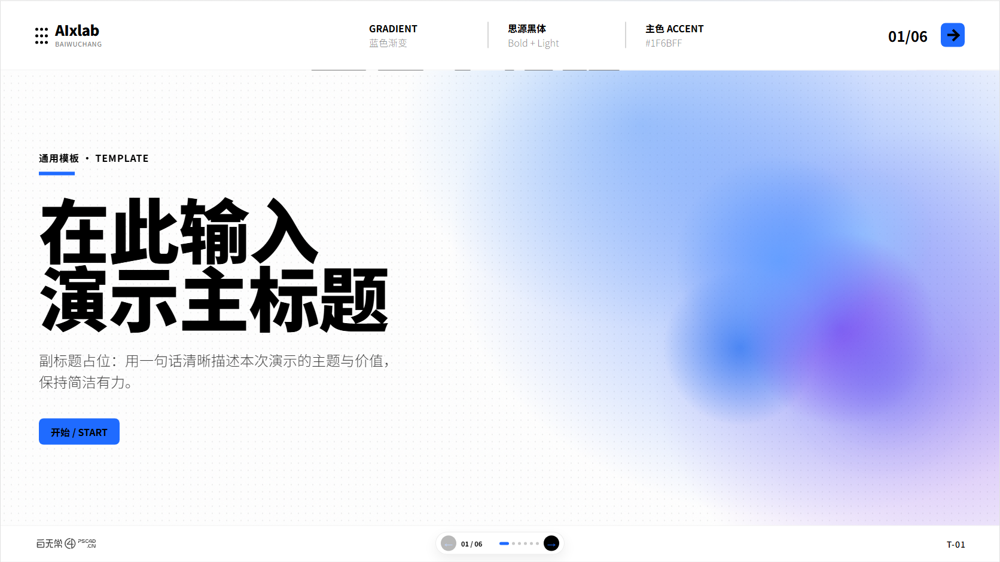
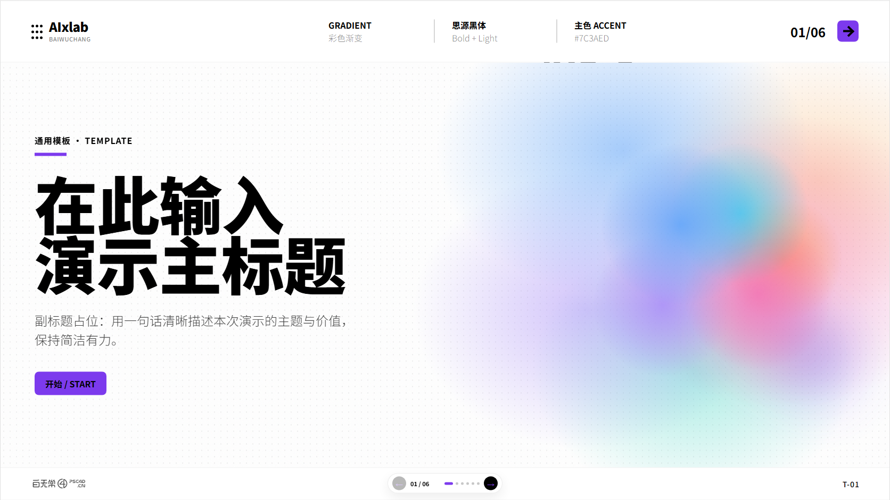

# Baiwuchang PPT HTML

**baiwuchang-ppt-html** is a Codex skill for creating Baiwuchang-style presentation decks in HTML and editable PowerPoint format.

## 中文介绍

**baiwuchang-ppt-html** 是一套「百无常」风格的 PPT / HTML 演示文稿生成 skill。它适合用来制作发布会页面、产品介绍、项目汇报、课程分享、作品集展示和轻量级品牌提案。

这个 skill 内置 **4 套同源视觉风格**：

- **极简 minimal**：白底、黑字、荧光绿强调色，适合通用演讲和产品说明。
- **暖橙 warm-orange**：橙红渐变光感，适合更有温度的品牌、课程、创意项目。
- **蓝色 blue**：蓝紫科技感，适合 AI、工具、系统、数据产品。
- **彩色 rainbow**：多色渐变但版式克制，适合视觉更强的发布页和创意表达。

它会交付两种文件：

- **HTML 网页 PPT**：可在浏览器中播放，支持键盘翻页，适合本地演示和网页展示。
- **可编辑 PPTX**：通过 `python-pptx` 生成原生 PowerPoint，文字是可编辑文本框，图片和 logo 可替换，不是整页截图。

设计系统遵循 `设计规范.md`：固定 1672 x 941 画布、白底黑字、单一强调色、密集小圆点背景、左下角灰色 logo、思源黑体 / Noto Sans SC 字体体系。

## English Introduction

**baiwuchang-ppt-html** is a presentation skill for generating Baiwuchang-style decks as both browser-based HTML slides and editable `.pptx` files.

It includes **four visual themes**:

- **minimal**: white canvas, black typography, neon green accent.
- **warm-orange**: soft orange-red gradient accents for warmer brand storytelling.
- **blue**: blue-violet technology tone for AI, tools, systems, and data products.
- **rainbow**: controlled multi-color gradient accents for expressive launches.

The skill produces:

- **HTML slides** that can be opened and presented directly in a browser.
- **Editable PowerPoint files** generated with native PowerPoint text boxes and replaceable images.

The visual system follows `设计规范.md`: fixed 1672 x 941 canvas, white background, black text, one accent color, dense dot grid, bottom-left gray logo, and Source Han Sans / Noto Sans SC typography.

## Preview

| Minimal | Warm Orange |
| --- | --- |
|  |  |

| Blue | Rainbow |
| --- | --- |
|  |  |

## Included

```text
baiwuchang-ppt-html/
  SKILL.md
  设计规范.md
  html参考/
    极简/
    暖橙/
    蓝色/
    彩色/
  scripts/
    build_pptx.py
    _image_placeholder.png
  示例png/
  交付示例/
    html-ppt/
    baiwuchang-ppt.pptx
```

## Usage

1. Read `设计规范.md` before generating a deck.
2. Choose one theme: `minimal`, `warm-orange`, `blue`, or `rainbow`.
3. Copy the matching folder from `html参考/` and replace the placeholder content.
4. Open `template.html` in a browser to present the HTML deck.
5. Generate an editable PowerPoint file:

```bash
python scripts/build_pptx.py
```

The generated sample PPTX is saved to:

```text
交付示例/baiwuchang-ppt.pptx
```

## Design Rules

- Use pure HTML/CSS for the HTML slides.
- Keep the canvas fixed at 1672 x 941.
- Use white background, black text, and only one accent color per theme.
- Keep the dense dot background consistent across pages.
- Keep typography bold for titles and light for body copy.
- Place the gray logo at the bottom left.
- Export PPTX as editable PowerPoint elements, not full-slide screenshots.

## Validation

Before publishing a generated deck, check:

- HTML slides turn pages normally.
- `data-page` totals match the slide count.
- All text remains selectable in HTML.
- PPTX opens in PowerPoint.
- PPTX text is editable.
- Images and logo can be replaced.
