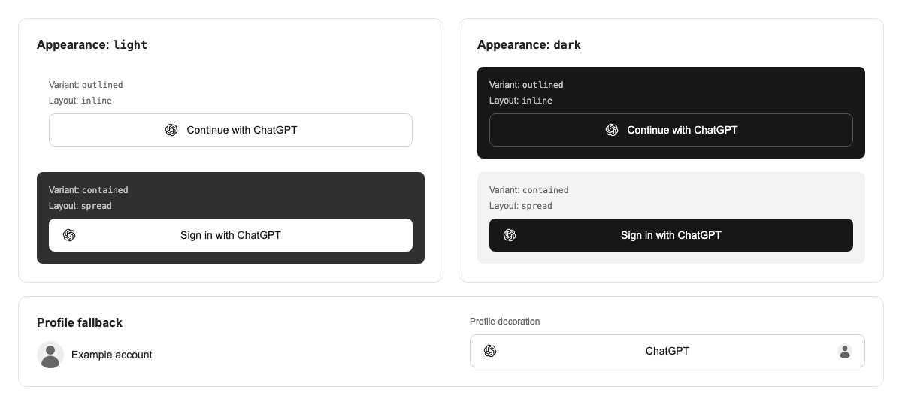

# Sign in with ChatGPT Auth SDK

Add Sign in with ChatGPT to your web app with localized buttons and shared
interaction state. Use `@openai/auth` for vanilla JavaScript or
`@openai/auth-react` for React. Both packages connect to your existing
authentication flow, while your app handles credential verification and session
management.



## Choose your integration

| Your application                                   | Start here                                                                                        |
| -------------------------------------------------- | ------------------------------------------------------------------------------------------------- |
| React 18 or 19                                     | [`@openai/auth-react`](packages/react/README.md) — components, hooks, and profile pictures        |
| Plain JavaScript or another UI framework           | [`@openai/auth`](packages/core/README.md) — DOM buttons and shared interaction state              |
| Next.js with Auth.js                               | [Complete example](examples/authjs/README.md) — OAuth configuration, server session, and React UI |
| Exploring the UI before configuring authentication | [Browser examples](examples/browser/README.md) — local simulated sign-in in DOM and React         |

The [getting-started guide](docs/getting-started.md) covers installation and the
authentication setup you need before connecting a button.

## Add a React button

Install both packages in your React application:

```sh
npm install @openai/auth @openai/auth-react
```

Wrap your sign-in view in `ChatGPTAuthProvider`:

```tsx
import { ChatGPTAuthProvider, ChatGPTSignInButton } from '@openai/auth-react';

export function SignIn() {
  return (
    <ChatGPTAuthProvider options={{ authPath: '/auth/chatgpt' }}>
      <ChatGPTSignInButton width="full" />
    </ChatGPTAuthProvider>
  );
}
```

`/auth/chatgpt` must be a route in **your application** that starts sign-in on a
GET request. The SDK does not create it. If your auth framework starts sign-in
through a JavaScript function, use an [adapter](docs/getting-started.md#connect-an-auth-client)
instead. The [Auth.js example](examples/authjs/README.md) demonstrates that approach.

Default styles load automatically. For an app that blocks inline styles, use
[external stylesheet mode](docs/csp.md).

## Add a DOM button

Install the core package:

```sh
npm install @openai/auth
```

Add a container to your page:

```html
<div id="sign-in"></div>
```

Mount the button after that element exists:

```ts
import { createChatGPTAuth } from '@openai/auth/client';

const auth = createChatGPTAuth({ authPath: '/auth/chatgpt' });
const button = auth.mountSignInButton(document.getElementById('sign-in')!, {
  width: 'full',
});

// To remove this button: await button.destroy();
// When the client is no longer needed: await auth.destroy();
```

The same requirement applies: your application must own the route. Use the
[DOM guide](packages/core/README.md) for shared buttons, session observation, error handling, and cleanup.

## Connect authentication

Choose one sign-in method:

- **`authPath`** navigates to a same-origin GET route in your application.
- **`adapter`** calls your auth client from the button click and reports
  completion, cancellation, or a redirect.

Register an OAuth client for your application before connecting the SDK.
Your backend or auth framework handles OAuth callbacks, token verification, and session cookies. An SDK `complete` event describes the sign-in
interaction. Read your application's session to determine whether the user is
signed in. The SDK does not expose tokens or discover a ChatGPT account before
your application has a session.

## Customize the experience

- [Button options and styling](docs/api.md#presentation-options): light/dark appearance,
  full-width buttons, layouts, and permitted layout styles.
- [Button branding](docs/branding.md): SDK presets, layout styles, and
  language/accessibility exceptions.
- [Profile pictures](packages/react/README.md#display-the-signed-in-profile): display
  profile information from your app's verified session.
- [Localization](docs/localization.md): choose a language and handle right-to-left layout.
- [State and recovery](docs/recovery.md): display progress and allow another attempt.
- [Accessibility](docs/accessibility.md): labels, keyboard behavior, focus, and errors.
- [HTTPS configuration](docs/authjs-https.md): configure callbacks and secure cookies
  for the Auth.js example.

See the [documentation index](docs/README.md) for all guides and the API reference.
For help, use [Support](SUPPORT.md) or [Security reporting](SECURITY.md).

## Work on the SDK

The [contributing guide](docs/contributing.md) explains how to run the examples,
build packages, maintain translations and notices, and check changes.

## License

The first-party code, examples, and documentation use the [Apache License 2.0](LICENSE).
The [third-party notices](NOTICE) identify library dependencies and adapted code.
Each SDK package includes its own notice file. See the
[notice maintenance instructions](docs/contributing.md#maintain-third-party-notices) when changing dependencies or builds.
