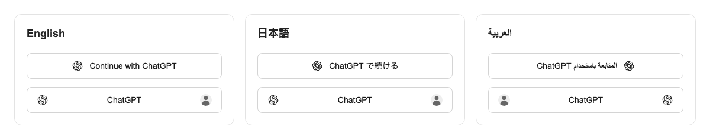

# Localization

Set `locale` on a sign-in button to choose its label language. The SDK includes
translations. Your application does not need a translation service, a localization
provider, or an extra network request.

## Available languages

| Language                | Locale    | Direction     |
| ----------------------- | --------- | ------------- |
| English                 | `en`      | Left to right |
| Amharic                 | `am`      | Left to right |
| Arabic                  | `ar`      | Right to left |
| Bulgarian               | `bg`      | Left to right |
| Bengali                 | `bn`      | Left to right |
| Bosnian                 | `bs`      | Left to right |
| Catalan                 | `ca`      | Left to right |
| Czech                   | `cs`      | Left to right |
| Danish                  | `da`      | Left to right |
| German                  | `de`      | Left to right |
| Greek                   | `el`      | Left to right |
| Spanish                 | `es`      | Left to right |
| Spanish (Latin America) | `es-419`  | Left to right |
| Estonian                | `et`      | Left to right |
| Persian                 | `fa`      | Right to left |
| Finnish                 | `fi`      | Left to right |
| Filipino                | `fil`     | Left to right |
| French                  | `fr`      | Left to right |
| French (Canada)         | `fr-CA`   | Left to right |
| Gujarati                | `gu`      | Left to right |
| Hindi                   | `hi`      | Left to right |
| Croatian                | `hr`      | Left to right |
| Hungarian               | `hu`      | Left to right |
| Armenian                | `hy`      | Left to right |
| Indonesian              | `id`      | Left to right |
| Icelandic               | `is`      | Left to right |
| Italian                 | `it`      | Left to right |
| Japanese                | `ja-JP`   | Left to right |
| Georgian                | `ka`      | Left to right |
| Kazakh                  | `kk`      | Left to right |
| Kannada                 | `kn`      | Left to right |
| Korean                  | `ko`      | Left to right |
| Lithuanian              | `lt`      | Left to right |
| Latvian                 | `lv`      | Left to right |
| Macedonian              | `mk`      | Left to right |
| Malayalam               | `ml`      | Left to right |
| Mongolian               | `mn`      | Left to right |
| Marathi                 | `mr`      | Left to right |
| Malay                   | `ms`      | Left to right |
| Burmese                 | `my`      | Left to right |
| Norwegian Bokmål        | `nb`      | Left to right |
| Dutch                   | `nl`      | Left to right |
| Punjabi                 | `pa`      | Left to right |
| Polish                  | `pl`      | Left to right |
| Portuguese              | `pt`      | Left to right |
| Portuguese (Portugal)   | `pt-PT`   | Left to right |
| Romanian                | `ro`      | Left to right |
| Russian                 | `ru`      | Left to right |
| Slovak                  | `sk`      | Left to right |
| Slovenian               | `sl`      | Left to right |
| Somali                  | `so`      | Left to right |
| Albanian                | `sq`      | Left to right |
| Serbian                 | `sr`      | Left to right |
| Swedish                 | `sv`      | Left to right |
| Swahili                 | `sw`      | Left to right |
| Tamil                   | `ta`      | Left to right |
| Telugu                  | `te`      | Left to right |
| Thai                    | `th`      | Left to right |
| Turkish                 | `tr`      | Left to right |
| Ukrainian               | `uk`      | Left to right |
| Urdu                    | `ur`      | Right to left |
| Vietnamese              | `vi`      | Left to right |
| Chinese (Simplified)    | `zh`      | Left to right |
| Chinese (Hong Kong)     | `zh-HK`   | Left to right |
| Chinese (Traditional)   | `zh-Hant` | Left to right |



Arabic, Persian, and Urdu place the logo on the right without mirroring it.
The profile decoration appears on the left.

The catalog covers the “Continue with ChatGPT” and “Sign in with ChatGPT” button
actions. Your application remains responsible for translating help text, errors,
session messages, and the rest of the sign-in experience.

## React

```tsx
import { ChatGPTAuthProvider, ChatGPTSignInButton } from '@openai/auth-react';

export function SignIn({ locale = 'en' }: { locale?: string }) {
  return (
    <ChatGPTAuthProvider options={{ authPath: '/auth/chatgpt' }}>
      <ChatGPTSignInButton locale={locale} text="sign-in" />
    </ChatGPTAuthProvider>
  );
}
```

Here your application implements `/auth/chatgpt`. Pass the language
from your application's locale setting, for example `<SignIn locale="ar" />`.

## DOM

```ts
import { createChatGPTAuth } from '@openai/auth/client';

const container = document.querySelector<HTMLElement>('#chatgpt-sign-in');
if (!container) throw new Error('Missing sign-in container');

const auth = createChatGPTAuth({ authPath: '/auth/chatgpt' });
const button = auth.mountSignInButton(container, {
  locale: 'ja-JP',
  text: 'sign-in',
});

// Update the mounted button when your application's language changes.
button.update({ locale: 'ar' });
```

Changing a locale updates the existing button and preserves any pending sign-in
attempt. React prop updates behave the same way.

## Locale matching and fallback

Set `locale` to a BCP 47 language tag to choose the button language.
An explicit `locale` overrides the document language. The SDK selects a catalog in this order:

1. Use a bundled catalog with the same base tag, excluding language-tag extensions.
2. Otherwise, use a catalog whose tag contains only the requested language and its specified or inferred script.
3. Otherwise, use a catalog with the same language and inferred script.
4. Otherwise, use a catalog for the same language.
5. If the language is unavailable, use English.

The SDK infers an omitted script from the language and region.
For example, `zh-TW` and `zh-Hant-TW` resolve to `zh-Hant`.
An exact `zh-HK` tag selects the `zh-HK` catalog.
Other examples include `ja` → `ja-JP`, `tl` → `fil`, `ar-EG` → `ar`, `fr-FR` → `fr`, and `de-DE` → `de`.
The unsupported tag `eo` uses `en`.
The SDK rejects malformed explicit `locale` values with an `invalid_presentation` error.
This includes an empty string. A valid but unsupported explicit language uses English.

Without `locale`, mounted DOM and React buttons use `<html lang>` from their own document.
The SDK uses English in these cases:

- The `<html>` element has no `lang` attribute.
- The `lang` attribute is empty.
- The `lang` value does not form a valid BCP 47 tag.
- No bundled catalog matches the `lang` value or its language.

Buttons without an explicit `locale` follow changes to `<html lang>`, including in iframe documents.
Remove the React `locale` prop to restore this behavior.
For a DOM button, call `update({ locale: undefined })` to restore this behavior.
The SDK does not read browser language preferences.

Without `locale`, React renders English on the server and during initial hydration.
It uses the document language after the button mounts, without replacing the button.
Pass the same explicit locale on the server and client to render translated labels immediately.

The pure `getChatGPTSignInButtonModel` does not read browser state.
It defaults to English without `locale`.

## Typeface and glyph fallbacks

The SDK keeps its default Latin typeface and adds locally installed font fallbacks
for the resolved label language. DOM styles, React server output, and the visual
model use the same font stacks. The SDK does not download or bundle fonts.
The device chooses the available glyph font. Unsupported locales use the English
label and its default stack. User font preferences remain supported.
Do not supply a partner font through button styles. See [branding](branding.md).

## Right-to-left layouts and accessible names

The button sets its own `lang` and `dir` from the **resolved** catalog.
Arabic, Persian, and Urdu buttons use RTL. All other bundled catalogs use LTR.
The host page's direction does not change the button's direction. Your application still sets the surrounding
document's direction.

The ChatGPT mark appears on the leading side of the label without mirroring the
artwork. In Arabic, Persian, and Urdu, this is the right side. Preserve this behavior when adding custom CSS.
`text="brand"` keeps the visible “ChatGPT” label and uses the full localized
“Sign in with ChatGPT” action as its accessible name.

For a custom renderer, `getChatGPTSignInButtonModel()` provides the resolved
`label`, `ariaLabel`, `lang`, `dir`, and `style.direction`. Apply these together so
the accessible name and reading direction stay consistent with the visible label.

## Try the localized controls

Complete the [repository setup](contributing.md#set-up-the-workspace). Run
`pnpm playground`. Open
[the local adapter demo](http://127.0.0.1:4319/). The **Button language**
selector switches between English, Japanese, Arabic, and Spanish (Latin America). Playground controls remain
in English, and this adapter mode simulates authentication locally. See the
[playground guide](playground.md) for setup and other controls.

See [catalog maintenance](contributing.md#maintain-localization) to update the
checked-in translations and generate the bundled labels.
