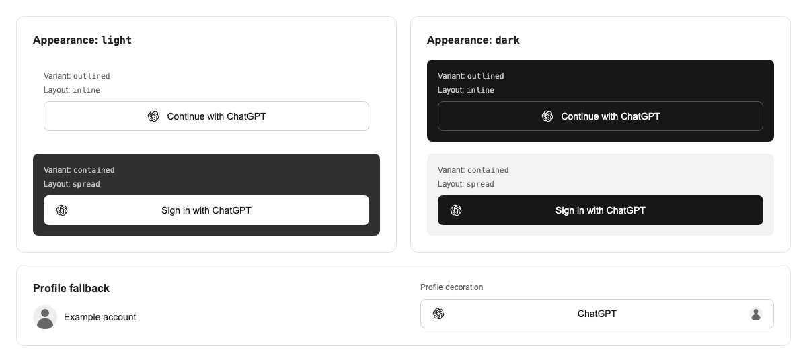

# Vanilla JavaScript and React examples

These examples connect the Sign in with ChatGPT UI to a local simulated authentication
service. They demonstrate both ways to connect the SDK to your app:

- An adapter for an existing authentication client.
- A same-origin sign-in route (`authPath`).

The examples require no OpenAI client registration, credentials, or external
service.

For a real OAuth integration, use the
[Next.js/Auth.js example](../authjs/README.md).



## Run the examples

Complete the [repository dependency setup](../../docs/contributing.md#set-up-the-workspace).
Run this command from the repository root:

```sh
pnpm examples
```

Open [Vanilla JavaScript](http://127.0.0.1:4320/vanilla) or
[React](http://127.0.0.1:4320/react). Stop the server with Ctrl+C. Restart
`pnpm examples` after you change SDK sources. Example source changes refresh automatically.

## Try a sign-in flow

1. Keep **Existing-auth popup adapter** selected. Click the ChatGPT button.
2. Choose **Complete demo sign-in** in the local popup. The example creates a simulated app
   session. It then reads that session independently of the SDK interaction result.
3. Both examples observe `adapter.session` through the core client. The vanilla
   example displays its status; React displays the profile picture. Reload the page to restore the profile. Select **Clear demo
   session** to restore the fallback picture.
4. Start another attempt. Cancel or close the popup. Try the error and redirect
   outcomes to see how the app handles each result.

Select **App-owned authPath** to try a redirect instead. The SDK navigates to a
same-origin route, which sends you to the simulated provider page. On return, the
app reads `/demo/api/session`. Navigation does not fire an SDK completion callback.
This mode has no adapter session source, so the SDK profile remains a fallback.

The recovery controls demonstrate how an app checks its session before it recovers a stalled interaction.
Check the session before you recover the interaction. Retiring a pending UI
attempt does not close its popup or cancel the external operation. The SDK ignores
a late result, but the app's own session can still change. See
[recovery semantics](../../docs/recovery.md).

## Adapt the example to your app

| File                                                      | What it demonstrates                                                                                    |
| --------------------------------------------------------- | ------------------------------------------------------------------------------------------------------- |
| [Vanilla consumer](src/vanilla.ts)                        | Create a client, mount a button, observe interaction and session state, and recover the UI.             |
| [React consumer](src/react.tsx)                           | Provider, profile components, hooks, accessibility props, and recovery controls.                        |
| [Auth adapter](src/local-auth.ts)                         | Opening a popup during the click, validating messages, mapping outcomes, and notifying session changes. |
| [Local provider](src/provider.ts) and [server](server.ts) | The simulated authentication service for these examples.                                                |

Replace the local provider with your existing authentication
system. Use that system's session backend. Keep that system's protections:

- OAuth state.
- Proof Key for Code Exchange (PKCE).
- Callback validation.
- Cross-site request forgery (CSRF) protection.
- Cookie controls.

The SDK manages the button's interaction state and reads display
fields from your session source. Your authentication system verifies identity and creates
the session.

The popup opens synchronously during the click so it retains browser user
activation. If your authentication client also uses a popup, call it before any asynchronous
work in your adapter. Preserve message origin, source, and attempt checks when
adapting the local client.

## Simulation limits

The browser navigation, popup behavior, subscriptions, and HttpOnly cookie
transport are real. The example simulates identity. Selecting **Complete demo sign-in** creates
an in-memory demo session without OAuth or identity verification. The displayed
profile and illustration contain test data. They do not contain OpenAI account data.

The server binds to loopback. It accepts requests only at its fixed origin. It uses
short-lived sessions. Its development cookies omit `Secure` because it serves
HTTP. Use these files to learn the SDK contract. Do not use them as a production authentication
service.

## Build and check

From the repository root:

```sh
pnpm typecheck
pnpm build
pnpm examples:build
```

The build produces static assets. The simulated session routes exist only in the
Vite development server, so use `pnpm examples` to try the complete demo.
