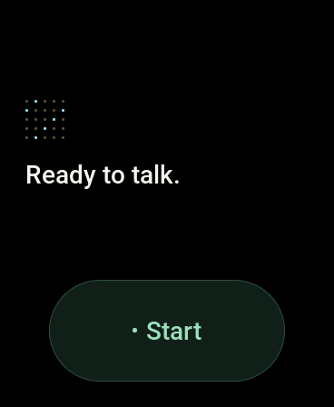
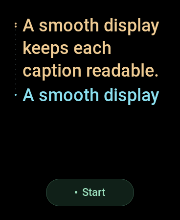
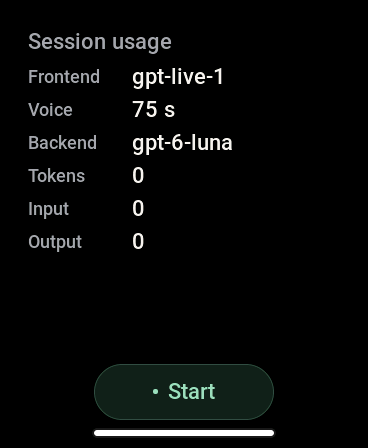

# OpenAI Live SDK for ESP32

> **Experimental project. Not officially supported by OpenAI.** This is a proof
> of concept, with no stability guarantees or support commitment.

Build a voice assistant with the [OpenAI Live API](https://developers.openai.com/api/docs/guides/live)
on supported ESP32 boards. The project has two parts.

1. **Core SDK:** a portable C protocol library and an ESP-IDF WebRTC/Opus adapter.
2. **Device examples:** a native Live Voice app for the **Waveshare
   ESP32-S3-Touch-AMOLED-1.8 V2**, integrated into its Brookesia launcher,
   standalone apps for the round **Waveshare ESP32-S3-Touch-AMOLED-1.75** and
   **M5Stack CoreS3 LITE**, and a screenless **Sonatino**
   headset example, plus **M5Stack StackChan** with camera/servos and
   **ESP-Mosaico** with camera, interaction module, and sensors.

**Watch: Running Voice Models on ESP32** — an 80-second demo on the Waveshare device.

https://github.com/user-attachments/assets/06a60f02-aeef-4a53-a377-453e5d0a028e

A separate [experimental portable WebRTC package](packages/peer) provides a
libpeer-derived C transport, host interoperability tests, and a security review.
It is independently buildable and supplies the device examples' WebRTC transport.

## Core SDK

The core SDK handles Live sessions, WebRTC transport, and audio streaming. Your
application supplies networking and microphone/speaker drivers; a display is
optional. The device apps below show how to connect these pieces to real hardware.

| Component | Purpose |
| --- | --- |
| [`components/live`](components/live) | Portable C API for session creation, JSON offer/answer, events, mute, and graceful close. Depends on cJSON; has no board or credential storage. |
| [`components/live_esp32`](components/live_esp32) | ESP-IDF adapter: HTTPS signaling, portable peer connection, Opus audio, transcript buffers, usage accounting, and startup timing. |
| [`components/live_peer`](components/live_peer) | ESP-IDF build and platform integration for the source-built WebRTC transport in `packages/peer`. |
| [`examples/protocol_smoke`](examples/protocol_smoke) | Hardware-independent ESP32-S3 protocol test firmware for QEMU and esp-emu. |

Start with the [core integration guide](docs/core.md) and
[`live_esp32.h`](components/live_esp32/include/live_esp32.h). Initialize the
adapter with your configuration and audio callbacks, then call
`live_esp32_start()` after Wi-Fi has an IP address. Audio callbacks exchange
24 kHz, signed 16-bit mono PCM. The portable C library in
[`live.h`](components/live/include/live.h) can also be used with another
transport implementation.

The SDK uses the public Live WebRTC JSON offer/answer protocol at
`POST https://api.openai.com/v1/live/sessions`. RTP carries audio; a reliable data
channel carries JSON events. This is the Live API, whose signaling and event
contract differs from the Realtime API.

### Customize the system prompt and Live configuration

The example apps initialize `live_esp32_config_t` in
[`LiveVoice.cpp`](examples/waveshare/LiveVoice.cpp) (Waveshare),
[`main.cpp`](examples/waveshare_round/main/main.cpp) (round Waveshare),
[`main.cpp`](examples/m5stack/main/main.cpp) (M5Stack),
[`main.cpp`](examples/stackchan/main/main.cpp) (StackChan),
[`main.cpp`](examples/mosaico/main/main.cpp) (Mosaico), or
[`main.cpp`](examples/sonatino/main/main.cpp) (Sonatino). Set these fields before
calling `live_esp32_init()`:

| Setting | Configuration | Example configuration |
| --- | --- | --- |
| Frontend instructions | `instructions` | Your board-specific system prompt; `NULL` keeps the adapter default |
| Startup greeting | `greeting` | Optional spoken welcome, up to 256 bytes; `NULL` keeps existing startup behavior |
| Frontend voice model | `model` | `LIVE_MODEL`, generated from the environment; defaults to `gpt-live-1` |
| Delegated Responses model | `responses_model` | `LIVE_RESPONSES_MODEL`, generated from the environment; defaults to `gpt-6-luna` |
| Backend instructions | `responses_instructions` | Instructions for the delegated backend, such as when to search and how to summarize findings |
| Backend service tier | `responses_service_tier` | `"priority"` in the device examples |
| Hosted web search | `responses_web_search` | `true` in the device examples; set `false` to omit the web-search tool |
| API key | `api_key` | `LIVE_API_KEY` from the private preparation step below |

Set the **frontend system prompt** on your board's configuration:

```cpp
config.instructions =
    "You are a friendly voice assistant. Keep answers brief and conversational. "
    "Delegate current-information questions to your backend and wait for its findings.";
```

`NULL` preserves the adapter's default prompt. `responses_instructions`
controls the delegated backend and does not replace the frontend prompt.
An optional `greeting` is submitted once after the session is active using
`session.commentary.append`, without a delegated backend call. The model may
paraphrase it, and the user can interrupt. A new connection gets a new greeting;
an ambiguous send failure is not retried. The cinema example opts into this.
The voice name remains a shared adapter setting (`cfg.voice` in
[`live_esp32.cpp`](components/live_esp32/live_esp32.cpp)); when using the portable
C library directly, set `live_config_t.instructions` and `live_config_t.voice`.
Rebuild and flash after changing settings.

Boards can opt into `capture_photo` and/or declare function tools through
`live_esp32_config_t.tools_json` with an `execute_tool` callback. The adapter
combines these with hosted web search, executes board calls sequentially on a
low-priority worker, and sends their results back to Responses. The callback
validates arguments, polls cancellation during hardware actions, and returns
bounded text. Existing voice-only apps need no changes. See the
[StackChan example](examples/stackchan/README.md#tools-and-motion-behavior) and
[callback contract](components/live_esp32/include/live_esp32.h).

### Set the API key and model names

For the device examples, save your API key as a single line in a private file
outside this checkout, such as `$HOME/.config/openai-live-esp32/api-key`, with
file permissions `600`. Pass it to your board's preparation script with
`--key-file`. For example, the Waveshare preparation command is:

```sh
LIVE_MODEL=gpt-live-1 LIVE_RESPONSES_MODEL=gpt-6-luna \
python tools/prepare_voice.py \
  --key-file "$HOME/.config/openai-live-esp32/api-key"
```

Use [`prepare_waveshare_round.py`](tools/prepare_waveshare_round.py),
[`prepare_m5stack.py`](tools/prepare_m5stack.py),
[`prepare_stackchan.py`](tools/prepare_stackchan.py), or
[`prepare_sonatino.py`](tools/prepare_sonatino.py) for those boards; each also
require `--wifi-file`, as shown in their device guides. All five scripts accept
`OPENAI_API_KEY` from the environment instead of `--key-file`. Change the model
environment variables above to use other models available to your account,
then rerun preparation, build, and flash using the chosen device guide.

Preparation generates `live_voice_secrets.h` in a private external cache. The
examples pass its `LIVE_API_KEY` to the HTTPS adapter. In your own application,
supply `live_esp32_config_t.api_key` through your provisioning mechanism and keep
the string alive for the controller's lifetime. The portable C library leaves
authentication to your transport.

The example firmware embeds the key and Wi-Fi credentials. **Do not publish
credential files, generated headers, build directories, firmware, or flash
backups.** No credentials or prebuilt firmware are included in this repository.
See [credential handling](SECURITY.md) for deployment considerations.

## Choose a device

This library is intended for ESP32 voice applications beyond the boards listed
here. These are **illustrative, working example apps**: use one on its named
device to get started, or adapt its board drivers and controls for your own
project. The same core SDK supports these integrations.

The ESP-IDF adapter targets dual-core **ESP32-S3 boards with PSRAM** and
the **ESP32-S31 Mosaico**. S3 examples use IDF 5.5.2; Mosaico uses a separate
pinned IDF 6.2 preview toolchain.
Other boards need compatible networking and audio drivers, sufficient memory,
and validation of task scheduling and audio performance. A display is optional;
the Sonatino example shows a screenless integration.

The examples use the same protocol, WebRTC transport, Opus audio, and
120 ms playback reserve. See each device guide for its validation status.

| Device | Audio and display | Session controls | Setup |
| --- | --- | --- | --- |
| Waveshare ESP32-S3-Touch-AMOLED-1.8 V2 | Built-in microphone/speaker; 368 × 448 AMOLED | Touch Start/Stop; USB commands and screen mirror | [Waveshare guide](examples/waveshare/README.md) |
| Waveshare ESP32-S3-Touch-AMOLED-1.75 | Built-in microphones; SPK connector for an external speaker; round 466 × 466 AMOLED | Touch Start/Stop; USB commands and idle screenshots | [Round Waveshare guide](examples/waveshare_round/README.md) |
| M5Stack CoreS3 LITE | Built-in microphones/speaker and camera; 320 × 240 LCD | Touch Start/Stop; USB commands | [M5Stack guide](examples/m5stack/README.md) |
| M5Stack StackChan (K151) | CoreS3 microphones/speaker/camera and LCD; feedback pan/tilt servos | Touch Start/Stop; voice-directed camera and head movement; USB diagnostics | [StackChan guide](examples/stackchan/README.md) |
| M5Stack StackChan Cinema (K151, separate example) | Silent SD-card films with on-device semantic search, plus the same voice/camera/motion tools | Touch the film to reveal Start/Stop; transcript-driven scenes | [Cinema guide](examples/stackchan_cinema/README.md) |
| ESP-Mosaico (ESP32-S31) | Microphone/speaker, 480 × 480 AMOLED, camera and interaction modules, IMU and haptics | Touch/AI/left-button Start/Stop; right-button mute; voice-directed camera, sensors, lights and infrared | [Mosaico guide](examples/mosaico/README.md) |
| Sonatino 3.1.x | External CTIA headset with mic; no display | BOOT release starts while idle; RESET reboots; USB `live stop` closes gracefully | [Sonatino guide](examples/sonatino/README.md) |

Sonatino requires its external antenna. Its BOOT button shares the audio clock
pin: **do not press BOOT during a call or audio test**. Firmware and pin mappings
are specific to each named board; do not flash one example onto another device.

## Waveshare screenshots

These are unmodified framebuffer captures from the app running on a physical
Waveshare device, not mockups. The Dot rail layout hides the launcher's status
bar and bottom gesture indicator. The usage reference predates the indicator
change; see [capture dates and details](docs/screenshots/README.md).

| Ready | Caption layout | Session usage |
| --- | --- | --- |
|  |  |  |

## Waveshare example app

[`examples/waveshare`](examples/waveshare) targets the **V2 CO5300 display** board
with 16 MB flash, 8 MB PSRAM, touch input, microphone, and ES8311 audio codec.
It provides:

- One Start/Stop button whose color reflects connection state.
- Compact cyan user captions and warm sand assistant captions with a dotted turn rail.
- A session-end page with model names, voice duration, and backend token usage.
- Saved Wi-Fi profiles and automatic fallback when a network is unavailable.
- Responses delegation with `gpt-6-luna`, priority tier, and hosted web search.
- USB controls for diagnostics, timing, and actual device screenshots.
- A [USB screen mirror](examples/waveshare/README.md#usb-screen-mirror-and-demo-recording)
  with a laptop viewer and screen-only video recording.

The example uses `gpt-live-1` for voice. Model availability and API usage charges
depend on your account. Model names can be configured at build time.
The launcher retains its other apps, including Settings, but excludes the vendor
Xiaozhi assistant and its separate font, emoji, prompt-audio, and speech-model
dependencies. Live Voice uses the shared Roboto fonts.

**[Build, configure, and flash the Waveshare app →](examples/waveshare/README.md)**

## M5Stack example app

[`examples/m5stack`](examples/m5stack) adapts the same SDK to the **CoreS3 LITE**:
a 320 × 240 touch UI, ES7210 microphones, AW88298 speaker, saved Wi-Fi profiles,
colored paginated captions, session usage, and camera questions. The Responses
backend can call `capture_photo`; the captured image appears on screen for two
seconds before captions return. Its board drivers and build are
separate from Waveshare; the protocol, WebRTC, Opus, and playback buffering are
shared. See the [build and flash guide](examples/m5stack/README.md).

## StackChan example app

[`examples/stackchan`](examples/stackchan) adds camera-guided head movement to
M5Stack's **StackChan K151**. Say “Look a little to the side and tell me what
you see”: the Responses backend can read the head pose, move the pan/tilt
servos, and capture a fresh photo. The example reuses the CoreS3 audio, camera,
and display implementation. Servo feedback, conservative angle/speed limits,
cancellation, and fault handling stay in its board layer. The base does not
drive. See the [hardware, setup, and tool guide](examples/stackchan/README.md).

## StackChan cinema example

[`examples/stackchan_cinema`](examples/stackchan_cinema) is a **separate app**
that replaces captions with silent archival film: conversation-driven visual
associations, camera-based historical counterparts, and idle dreams. Both text
embedding and video lookup run on the ESP32; no laptop server or embedding API
is needed at runtime. Movie files live on microSD, with a small preview in
flash. Live voice and camera interpretation still use the OpenAI API.
See the [cinema preparation, card loading, and build guide](examples/stackchan_cinema/README.md).

## Sonatino example app

[`examples/sonatino`](examples/sonatino) runs the shared stack on the **Sonatino
revision 3.1.x** audio board with a CTIA headset. USB commands provide session
control, volume, transcript snapshots, and diagnostics. Once Wi-Fi connects,
press and release BOOT while idle to start; use RESET to end by rebooting, or
USB `live stop` for graceful close. It has no screen or launcher and does not
start a session automatically. See the
[hardware setup and build guide](examples/sonatino/README.md).

## Build and test the core

Install [ESP-IDF 5.5.2](https://docs.espressif.com/projects/esp-idf/en/v5.5.2/esp32s3/get-started/index.html),
including its ESP32-S3 tools, and activate its `export.sh`. The documented command
line workflow targets macOS/Linux. From this repository:

```sh
cmake -S . -B build-host -G Ninja -DCMAKE_BUILD_TYPE=Debug
cmake --build build-host
ctest --test-dir build-host --output-on-failure
python -m unittest discover -s tests -p 'test_*.py'
```

Native tests cover protocol parsing and lifecycle, Wi-Fi selection, transcript
buffering, PCM conversion/priming, usage snapshots, response deduplication,
TLS cache lifecycle, and Sonatino button debouncing. They use synthetic fixtures,
need no API key, and enable ASan/UBSan by default. Use
`-DLIVE_SANITIZE=OFF` if your compiler lacks those runtimes.

To run the portable protocol tests as ESP32-S3 firmware:

```sh
idf.py -C examples/protocol_smoke set-target esp32s3 build merge-bin
python tools/run_emulator.py qemu
python tools/run_emulator.py esp-emu
```

Install the desired emulator first; see [testing and emulation](docs/testing.md).
Emulator tests cover protocol/runtime behavior, not the board's microphone,
speaker, display, Wi-Fi reliability, or a complete voice call.

## Current limits

This is an early SDK. A bounded 120 ms playback reserve absorbs short arrival
delays; it is not an adaptive jitter buffer. There is no acoustic echo
cancellation or packet-loss concealment in the example. Audio quality and
interruptions need further tuning.
The named Waveshare V2, M5Stack CoreS3 LITE, and Sonatino 3.1.x boards have been
exercised end to end. These are short hardware checks, not long-duration soak
tests. Other boards need their own audio/display integration.

The portable core supports creation, mute, close, and raw event forwarding.
It does not yet provide typed APIs for arbitrary tools, session updates, or
client-delegation completion. Payload and buffer limits are documented in the
[core guide](docs/core.md). Reconnection creates a new session.

Live reports voice usage in seconds, not frontend token counts. Backend tokens
come from delegated Responses events. After an interrupted connection, the last
received snapshot may omit in-flight usage. See the public
[usage guide](https://developers.openai.com/api/docs/guides/voice-latency-cost#monitor-actual-usage).

## License and contributions

Original SDK/example code and locally maintained portable transport changes are
provided under the [Apache License 2.0](LICENSE). See [NOTICE](NOTICE) for
attribution.
The portable WebRTC package retains libpeer's MIT attribution and uses separately
licensed cryptographic and SCTP dependencies. The shared UI fonts use Apache-2.0 Roboto 2.138;
[font provenance](examples/common/fonts/README.md) includes the exact source and
regeneration steps. Downloaded launcher/LVGL fonts retain their separate terms. All five ESP-IDF examples use an audio codec with
Espressif-only terms; Waveshare and M5Stack also resolve other restricted
components. Those terms do not apply to the standalone portable transport.
See [third-party notices](THIRD_PARTY_NOTICES.md)
for the dependency inventory, license exceptions, and upstream sources.

See [CONTRIBUTING.md](CONTRIBUTING.md) for contribution guidelines and the
[Contributor License Agreement](CLA.md). Support and response times are not
guaranteed. Include your board revision, ESP-IDF version, reproduction steps,
and sanitized logs. Do not include API keys, Wi-Fi credentials, private
conversations, or firmware images.
